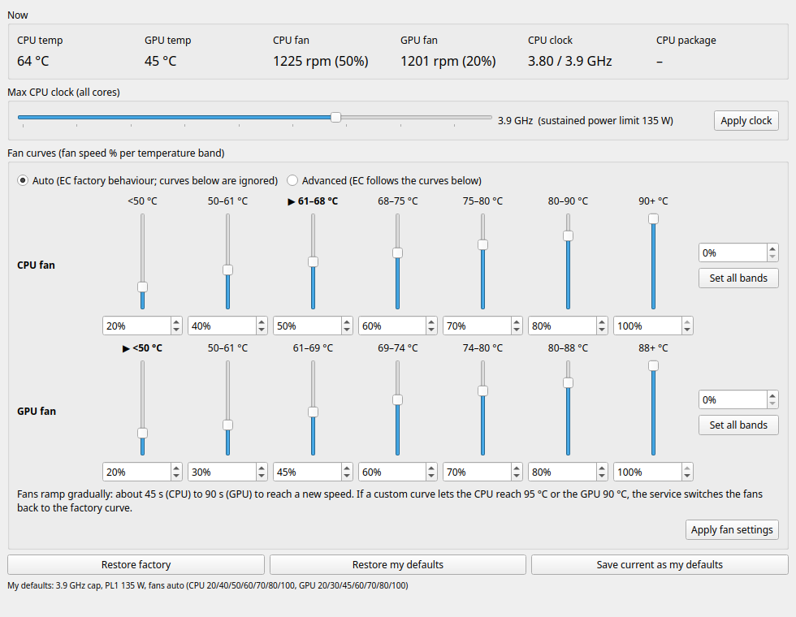

# gt76-fanctl

Fan-curve, CPU clock-cap and temperature control for the **MSI GT76 Titan DT 10SGS** on Linux
(KDE Plasma), working **with Secure Boot enabled**. It's an unofficial community tool, not
affiliated with MSI.



- **Fan curves**: set the CPU and GPU fan speed for each of the EC's seven temperature bands,
  like MSI's Windows "Advanced" fan mode.
- **Clock cap**: one slider (0.1 GHz steps) caps every core's maximum clock, so clock speed stays
  fixed regardless of how many cores are busy. A matching sustained power limit (PL1) is set
  automatically as a noise safety net.
- **Live readings**: CPU and GPU temperature, fan RPM and fan level, average clock, and CPU package power.
- **Restore factory / Restore my defaults / Save current as my defaults**. Defaults are applied at
  every boot.

> **Only for this exact hardware.** The service refuses to write to the embedded controller (EC)
> unless the EC firmware is `17H3EMS1.102` and the fan-curve tables are where expected. Writing
> to the EC of other models can misbehave until the EC is reset by a full power-off.

## How it works

| Part | Runs as | Does |
|---|---|---|
| `fanctld.py` (systemd `gt76-fanctld`) | root | Owns all hardware writes; validates requests; applies your defaults at boot; re-applies settings every 2 s if anything drifts (EC reset, resume from sleep); thermal failsafe |
| `fanctl_gui.py` (PyQt6) | you | Talks to the service over `/run/gt76-fanctl.sock` (mode 0660, your group) |

**Thermal failsafe:** if a custom curve lets the CPU reach 95 °C or the GPU 90 °C for about 6 s,
the service switches the fans back to the factory curve until you apply new settings. The CPU's
own throttle (about 97 °C) and shutdown protection work independently of this.

### Hardware details discovered for this model

| What | Where |
|---|---|
| CPU / GPU temperature | EC `0x68` / `0x80` (°C) |
| CPU fan curve: 6 thresholds, 7 speeds | EC `0x6A–0x6F` (50/61/68/75/80/90 °C), `0x72–0x78` (%) |
| GPU fan curve: 6 thresholds, 7 speeds | EC `0x82–0x87` (50/61/69/74/80/88 °C), `0x8A–0x90` (%) |
| Current fan level | EC `0x71` (CPU), `0x89` (GPU) |
| Fan mode | EC `0xF4`: `0x0C` auto (EC ignores the speed tables), `0x8C` advanced (EC follows them) |
| Fan tachometers | EC `0xCC–0xCD` (CPU), `0xCA–0xCB` (GPU): 16-bit big-endian period, rpm = 478000 / value |

Fans ramp gradually: about 45 s for the CPU fan and 90 s for the GPU fan. Measured speed by level:

| Level | 20 % | 30 % | 40 % | 50 % | 60 % | 70 % | 80 % | 90 % |
|---|---|---|---|---|---|---|---|---|
| rpm | 1,200 | 1,800 | 2,400 | 3,000 | 3,600 | 4,150 | 4,750 | 5,300 |

Levels between 1 and 20 % behave like 20 %, levels above 90 % behave like 90 %, and 0 % stops the fan.

The CPU (i9-10900K) shares one clock across all cores; package power scales roughly with the
cube of clock (about 100 W at 3.7 GHz up to about 147 W at 4.2 GHz under full AVX2 load).
Keep PL2 well above real draw: a PL2 near actual draw is enforced every 2.4 ms and makes the clock
oscillate. Ubuntu's `thermald` can silently reset PL1, so masking it is recommended
(`sudo systemctl mask --now thermald`); the CPU still protects itself thermally.

## Requirements

1. **EC access under Secure Boot: the msi-ec driver in debug mode, signed.** Kernel lockdown
   blocks `ec_sys` writes, but a signed `msi-ec` module may write the EC. Ubuntu's built-in
   msi-ec doesn't support this EC firmware and has no debug option, so build the upstream
   [BeardOverflow/msi-ec](https://github.com/BeardOverflow/msi-ec) with DKMS (DKMS signs it with
   your machine's MOK key):
   ```bash
   sudo apt install dkms
   git clone --depth 1 https://github.com/BeardOverflow/msi-ec.git && cd msi-ec
   VER=$(sed -n 's/^VERSION := //p' Makefile.vars)
   sudo mkdir -p /usr/src/msi-ec-$VER
   sudo cp dkms.conf Makefile Makefile.vars msi-ec.c ec_memory_configuration.h /usr/src/msi-ec-$VER/
   sudo sed -i "s/@VERSION@/$VER/" /usr/src/msi-ec-$VER/dkms.conf
   sudo dkms install msi-ec/$VER
   ```
   If the MOK key isn't enrolled yet (`mokutil --test-key /var/lib/shim-signed/mok/MOK.der`):
   run `sudo mokutil --import /var/lib/shim-signed/mok/MOK.der`, set a one-time password,
   reboot, and choose **Enroll MOK** on the blue screen. `install.sh` configures the
   `debug=1` option and loads the module at boot.
2. Python 3 with PyQt6 (`sudo apt install python3-pyqt6`), KDE Plasma 6 for taskbar pinning.

## Install

```bash
./install.sh            # asks for your password once; pins "GT76 Fan Control" to the taskbar
./install.sh --no-pin   # same, without touching the taskbar
```

## Uninstall

```bash
./uninstall.sh          # restores factory settings, removes the service and app
```

## Finding a quiet configuration

1. In **Advanced** mode, use **Set all bands** to pin a fan at one speed and listen; repeat to find
   the loudest acceptable speed. (In testing, fans became noticeable around 2,400 rpm over an idle of
   about 1,200 rpm.)
2. Keep that curve and find the highest clock where temperatures settle below about 90 °C.
   `tools/clock_sweep.py` automates this through the service (no root needed): for each clock
   it cools the CPU, runs 2 minutes of full all-core load with power limits off, records
   temperatures, fan speed, power and throughput, stops at the first clock that throttles or
   trips the failsafe, and restores your settings:
   ```bash
   python3 tools/clock_sweep.py sweep.json 3800 3900 4000 4100 4200
   ```
   With the CPU fan capped at 65 % (about 3,900 rpm), this machine reached 76 / 83 / 87 / 92 °C
   at 3.8 / 3.9 / 4.0 / 4.1 GHz after 2 minutes, and throttled at 4.2 GHz.
3. **Save current as my defaults.**

## Tests

```bash
python3 -m unittest discover -s tests   # fake /sys tree + in-memory EC; no hardware touched
```

## License

MIT
